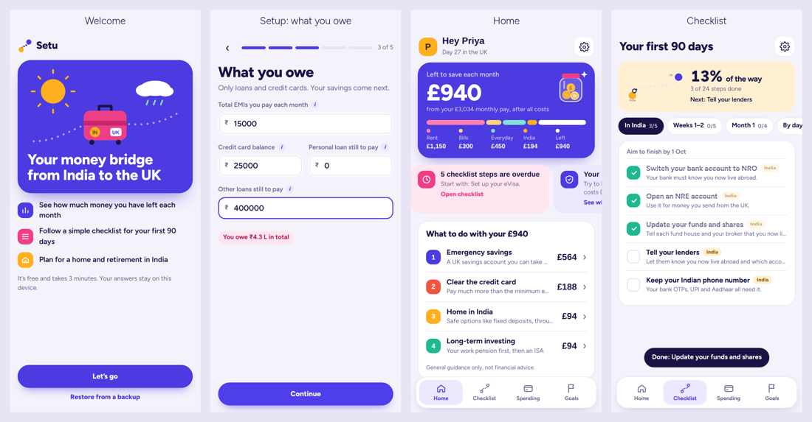

# Setu

**🌐 Use Setu free: [myselfsislam.github.io/setu](https://myselfsislam.github.io/setu/)** · [Guides for Indians in the UK](https://myselfsislam.github.io/setu/guides/)

**Your money bridge from India to the UK.** A free, private money planner for people moving from India to the UK.



## What it does
- Shows how much money you have left each month after UK costs and India payments
- Suggests a simple order for that money: emergency savings, expensive debt, a home in India, long-term investing
- A first-90-days checklist for both countries, with dates based on when you moved
- Tracks everyday spending against a monthly budget
- Plans for retirement and a home back in India

## Features
- **Monthly money:** take-home pay (England, Wales, NI or Scotland, 2026/27 rates), costs, India payments and what's left, in pounds and rupees
- **Spending:** quick logging, budgets by category, spending-pace warning, month-end forecast, repeating costs, search and filter, CSV export
- **Checklist:** first 90 days in the UK and India, with dates from your move
- **Goals:** retirement and a home in India, with fund types and their past performance
- **Freedom:** your financial freedom date and age, freedom number, coast number, lean/comfortable/fat freedom, live "what if" sliders (extra investing, yearly step-up, growth, inflation, withdrawal rate) and what brings the date sooner; retire in India (₹) or stay in the UK (£)
- **Growth:** what you put in vs what it's grown to, month-by-month growth, yearly return (XIRR), what your investments could pay you each month, milestones with expected dates, and a 5–25 year projection
- **Autopilot:** monthly investment rules (standing order, payroll pension, SIP auto-debit, scheduled transfer, or a reminder) with yearly step-ups; automatic ones record themselves into your holdings on the date, reminders get a "Mark done"; suggestions from your plan, a payday routine, a calendar (.ics) file with monthly reminders, and how to set each one up for real. Setu never moves money.
- **Live markets:** pound vs rupee, dollar and euro; Indian index moves; key UK and India rates
- **News:** headlines about your chosen investments, plus UK and India tax and policy changes (wide screens)
- **Email drafts:** ready-to-send emails (bank NRO/NRE, fund houses, lenders, council tax, payroll, HR) to copy into any email service
- **Transfer cost checker:** see the hidden exchange-rate cost of sending money home
- **Installable app (PWA):** add to home screen, works offline, and keeps data safer on iPhone
- **Backups:** download a backup file and restore it on another device

## Privacy
No accounts, no ads, no tracking and no cookies. Fonts are self-hosted. The only outside requests are for public data (exchange rates, fund prices and news), and none of the user's data is sent with them.

Everything runs in the browser. Data is saved only on the visitor's own device (browser local storage) and is never sent anywhere.

## Run it
It's a single static file. Open `index.html` in a browser, or host the folder on any static host.

### Deploy on Render
New > Blueprint (uses `render.yaml`), or New > Static Site with publish directory `.` and no build command.

## Disclaimer
General guidance only, not financial, tax or immigration advice.

## Tests
Run every check (features, take-home maths, accessibility, layout on 10 screen sizes):
```
pip install playwright && python -m playwright install --with-deps chromium
npm i axe-core@4
python tests/run_all.py
```
See `MAINTENANCE.md` for the upkeep calendar.
